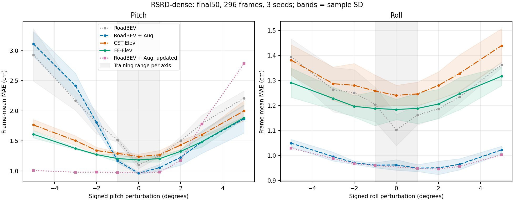
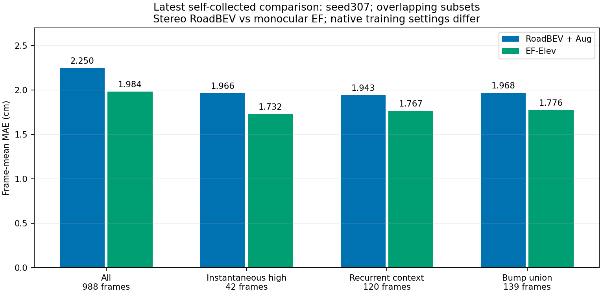

# EF-Elev: Extrinsic-Free BEV Road Elevation Evidence

An English-only evidence and reproduction package for monocular BEV road elevation estimation, attention-anchored fine-feature sampling (AFS), and decoupled image-attitude shift (IAS) / metadata bias (MB) evaluation.

Snapshot: **2026-10-25**. This package reorganizes existing experiments and adds offline analysis. It does not add training or model inference runs.

## Main results

RSRD-dense uses 2,468 training frames and 296 test frames, fixed final50 checkpoints, and seeds 307, 1101 and 2202. Values are frame-mean MAE in centimeters; uncertainty is sample SD across training seeds.

| Method | Clean MAE | Pitch +/-5 degrees, stale projection | Roll +/-5 degrees, stale projection |
|---|---:|---:|---:|
| RoadBEV | 1.102 +/- 0.062 | 2.569 | 1.379 |
| RoadBEV + Aug | 0.962 +/- 0.021 | 2.488 | 1.036 |
| CST-Elev, no AFS | 1.241 +/- 0.040 | 1.881 | 1.411 |
| EF-Elev, with AFS | 1.184 +/- 0.041 | 1.746 | 1.304 |

The pitch advantage is conditional: EF-Elev overtakes the augmented stale-projection baseline from the **sign-averaged 2-degree setting**. Clean and roll results favor the augmented explicit baseline. Signed curves retain the directional asymmetry. Updated-projection controls are included separately.



The latest self-collected comparison uses 2,552 / 1,205 / 988 fixed training / validation / test frames, seed307, and validation-selected checkpoints.

| Test subset | Frames | Stereo RoadBEV + Aug | Monocular EF-Elev | EF MAE reduction |
|---|---:|---:|---:|---:|
| All | 988 | 2.250 | 1.984 | 11.8% |
| Instantaneous high motion | 42 | 1.966 | 1.732 | 11.9% |
| Recurrent high-motion context | 120 | 1.943 | 1.767 | 9.0% |
| Deduplicated bump union | 139 | 1.968 | 1.776 | 9.8% |

These subsets overlap. Native input modalities, augmentations and training settings differ, so this is a **method-level comparison**, not a controlled AFS ablation. Motion labels are IMU proxies; the targets are exploratory plane-relative residuals. The test material belongs to one acquisition session and route independence is unconfirmed.



## Experiments and evidence

- [Experiment protocol and limitations](docs/PROTOCOL.md): input dependencies, GT frames, masks, selection, versions and statistics.
- [Review-response evidence map](docs/REVIEW_RESPONSE.md): what the existing experiments resolve and what remains untested.
- [Results interpretation](docs/RESULTS.md): ablations, shape analysis, real attitude groups, anchors and historical efficiency.
- [Figure index and captions](docs/FIGURES.md): qualitative successes, all seeds for the same frames, and epoch40 supplements.
- [Reproduction guide](docs/REPRODUCIBILITY.md): offline reconstruction, prediction-cache evaluation and optional checkpoint replay.
- [References and attribution](docs/SOURCES.md): verified primary sources and third-party notices.
- [Acceptance report](docs/ACCEPTANCE.md): checks completed for this package.

`evidence/` contains frame records, source bindings, immutable-source hashes, selection records and compact figure arrays. `results/` contains rebuilt tables. `src/` contains the required native model components, and `configs/` preserves historical run settings for provenance.

## Reproduce the evidence

Python 3.12 was used for the offline reconstruction. No GPU, checkpoints or full dataset download is required for the commands below.

```bash
python -m venv .venv
# Activate the environment using your platform's standard command.
python -m pip install -r requirements-lock.txt
python -m unittest discover -s tests -v
python -m scripts.build_tables
python -m scripts.paired_analysis
python -m scripts.render_figures
python -m scripts.verify_release
```

Full datasets and large checkpoints are excluded. Selected image and array assets are included solely as traceable research examples. Dataset and upstream code terms remain applicable; see [data access and attribution](docs/SOURCES.md).

## Interpretation boundaries

The older 1,139-frame self-collected AFS study is preserved as a separate version, including its clean-accuracy disadvantage. RSRD acquisition-session labels remain unresolved: `official_test` is a split placeholder, and the IDs span five dates. No cross-session confidence interval or independent-route generalization claim is made. Three training seeds do not repair temporal overlap or prior test-set use during method development.
